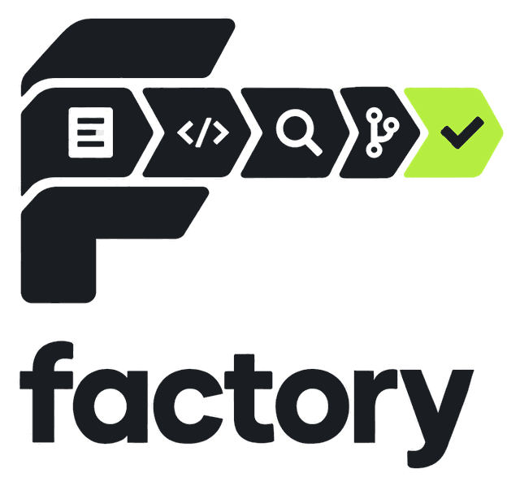
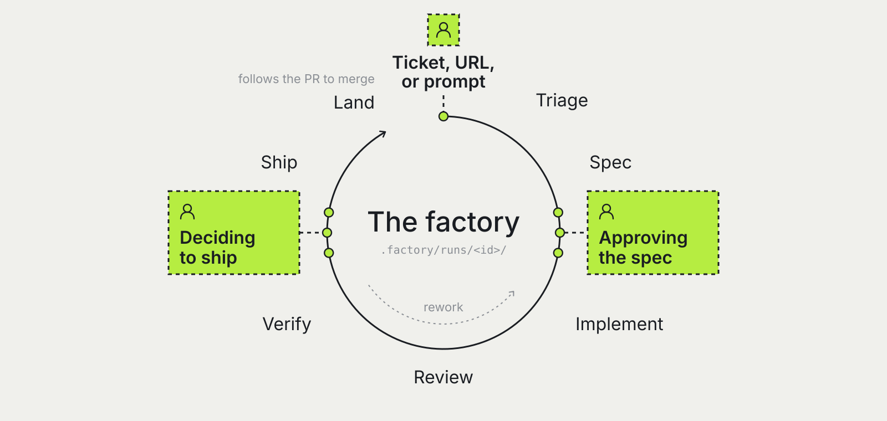

<p align="center">
  <picture>
    <source media="(prefers-color-scheme: dark)" srcset="docs/assets/logo-dark.png">
    
  </picture>
</p>

<h3 align="center">From ticket to merge-ready PR, with a human on every call that matters.</h3>

<p align="center">
  <a href="https://github.com/katiawheeler/factory/actions/workflows/test.yml"></a>
  <a href="testing/evals/README.md"></a>
  
  
  <br>
  <a href=".agents/skills/factory/SKILL.md"></a>
  <a href=".agents/skills/factory/agents/openai.yaml"></a>
  
  <a href="https://github.com/katiawheeler/factory/commits/main"></a>
</p>

<p align="center">
  <a href="#install">Install</a> ·
  <a href="#use">Use</a> ·
  <a href="#automate-it">Automate it</a> ·
  <a href="#architecture">Architecture</a> ·
  <a href="#documentation">Docs</a>
</p>

---

**factory** is a software factory for any coding agent that can read a skill and run Git and Python. Give it a ticket, URL, or prompt: it triages the request, writes a spec, implements it on a branch, reviews and verifies the work, opens a PR, and follows that PR through CI and review until it merges or closes. A human approves the spec and the decision to ship, unless the repo opts in to automating them. It never merges or deploys; merging stays a human's call.

<p align="center">
  
</p>

## Why factory

<table>
  <tr>
    <td width="50%">📝 <b>Spec before code.</b> Triage grounds the request in your repo, and the spec turns it into testable acceptance criteria you approve. <a href="docs/how-it-works.md">How it works →</a></td>
    <td width="50%">🔬 <b>Proof, not promises.</b> Verify runs the change, drives UI with Playwright, and puts the evidence for every criterion in the PR. <a href="docs/pull-requests.md">Pull requests →</a></td>
  </tr>
  <tr>
    <td width="50%">🛬 <b>Follows the PR to merge.</b> Red CI, merge conflicts, and review comments go back through implement, review, and verify, and land on the same PR. <a href="docs/pull-requests.md">Pull requests →</a></td>
    <td width="50%">💬 <b>Answer from anywhere.</b> Approve with <code>/factory approve</code> on the issue or PR, and get notified wherever you like. <a href="docs/usage.md">Install and use →</a></td>
  </tr>
  <tr>
    <td width="50%">🧠 <b>Gets better every run.</b> Each finished run's retro teaches the next one, and merged runs are checked for reverts and failures. <a href="docs/learning.md">Measuring and learning →</a></td>
    <td width="50%">🛡️ <b>Safe by default.</b> Every run gets its own worktree; it never merges or force-pushes, and it ignores commands from people without write access. <a href="docs/architecture.md">Architecture →</a></td>
  </tr>
  <tr>
    <td width="50%">⚙️ <b>Automate as trust grows.</b> Skip stages for one run or every run, or auto-approve small, clear specs. <a href="docs/automation.md">Automation →</a></td>
    <td width="50%">📊 <b>Measured, not guessed.</b> Run stats track time, rounds, and outcomes, and evals with hidden tests catch prompt regressions. <a href="docs/development.md">Development →</a></td>
  </tr>
</table>

## Install

```sh
npx skills add katiawheeler/factory
```

Or copy [`.agents/skills/factory/`](.agents/skills/factory/SKILL.md) into your agent's skill directory. The factory needs Git and Python 3, and `gh` (or your agent's GitHub tools) for GitHub. See [Install and use](docs/usage.md).

## Use

Replace `<factory>` with your agent's way of invoking a skill (`/factory` in Claude Code, `$factory` in Codex):

```text
<factory> <ticket | URL | prompt>    Start a run
<factory>                            List runs and their stages
<factory> <run-id>                   Resume a run; at land, check the PR again
<factory> <run-id> approve           Approve the spec (checkpoint 1)
<factory> <run-id> ship              Approve shipping and open the PR (checkpoint 2)
<factory> <run-id> <feedback>        Request changes, answer a question, or ask for a PR fix
<factory> <run-id> pause|abort       Pause or abort
```

Each run works in its own Git worktree, so your checkout and uncommitted changes are left alone, and its state lives in `.factory/runs/<run-id>/`, so a run survives a dead session. Checkpoints can also be answered with `/factory approve` comments on the issue or PR. All commands: [Install and use](docs/usage.md).

## Automate it

Skip stages for one run, or for every run in a repo:

```text
<factory> --skip review,checkpoint-2 <input>       # this run only
git config factory.skip checkpoint-1,checkpoint-2  # every run: input to PR with no human approvals
```

Any of `triage`, `spec`, `checkpoint-1`, `review`, `verify`, `checkpoint-2`, or `all`. Implement, ship, and land always run, so every run still ends in a PR that a human merges, and escalations still stop for a human. See [Automation](docs/automation.md) and [Settings](docs/settings.md).

## Architecture


`state.py` is the only thing that writes run state: it refuses stage moves the loop doesn't make, applies the skip settings, and locks each run while changing it. See [Architecture](docs/architecture.md).

## Documentation

| Guide | What's in it |
|---|---|
| [How it works](docs/how-it-works.md) | Stages, outputs, human decisions, loop caps, worktrees |
| [Install and use](docs/usage.md) | Every command and how checkpoints are answered |
| [Pull requests](docs/pull-requests.md) | The PR report, landing the PR, answering from GitHub |
| [Automation](docs/automation.md) | `--skip`, `factory.skip`, and auto-approving small specs |
| [Settings](docs/settings.md) | Every `factory.*` setting, and notifications |
| [Measuring and learning](docs/learning.md) | Run stats, retros and learnings, signals after merge |
| [Development](docs/development.md) | Tests, CI, and evals |

---

<p align="center">
  <sub>Inspired by Warp's <a href="https://www.warp.dev/blog/a-guide-to-cloud-software-factories-for-engineering-leaders">guide to cloud software factories</a>.</sub>
</p>
